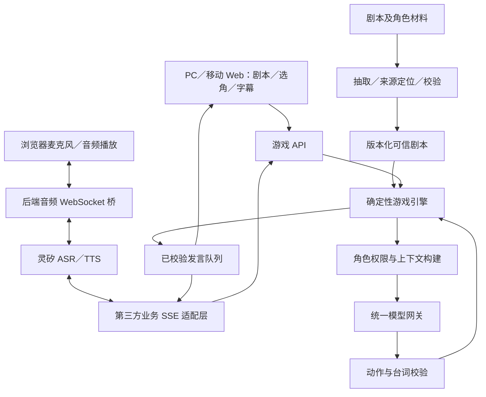

# Cyber DM：需求与首版技术方案

状态：方案已进入实现；具体已实现和未完成范围以 README 与测试证据为准。更新日期：2026-10-23（Asia/Shanghai）。

## 1. 目标和已确认约束

用户上传剧本，任选一个玩家角色，以语音完成一局剧本杀。其余玩家角色、配角及 DM 由 AI 扮演。优先交付完整可玩闭环。

- 不同角色必须隔离私有上下文；允许共享在场角色实际听到的公开发言。
- 不允许影响剧情的幻觉：不得新增关键线索、改变事实、凭空生成证据或提前泄露真相。
- 每个角色及 DM 可独立选择 provider、模型和参数，支持 GPT／Claude 中转站、DeepSeek、千问、豆包等配置。
- 自动匹配自然、易区分的默认声音；支持上传参考音频指定角色声音。
- 产品主入口为响应式 Web，PC 和移动设备浏览器都必须支持麦克风语音输入、角色音频播放及完整打本流程；不能要求安装原生客户端或购买硬件。
- 灵矽承担后端语音接入；用户已提供公开文档。
- 优选：宣传页、真人摄影风格的虚构角色头像、代表性台词试听；按要求修改或生成剧本。
- 先完成需求与技术方案，再按持续项目目标实现；文档交付不等于软件完成。
- Web 版为首版最高优先级；原生音频客户端列为验收后的改进优化项，不作为首版交付依赖。

### 时间和预算

| 项目 | 已确认约束 |
| --- | --- |
| 首版验收交付 | 2026-10-24 20:00，Asia/Shanghai |
| 验收及改进 | 2026-10-25 |
| 项目总模型预算 | 500 美元 |
| 首版最高预算 | 400 美元，保留至少 100 美元用于验收后改进 |
| 执行精度 | 用户允许近似控制，不要求严格完美硬限额 |

用户截图的 gpt-6-astra 价格：普通输入 $10／百万 token，输出 $50／百万 token，缓存读取 $1、缓存写入 $12.5。缓存两项单位暂按百万 token 理解，需以实际平台账单核对。此价格是用户指定平台的报价，不宣称是官方统一价格。

预算默认涵盖本项目开发模型消耗及可归属本项目的模型／语音／图像联调费用，先按本次项目开始起算；实际平台已有消耗和其他服务价格尚不明确。避免两类消耗重复记账。未获得分类 usage 时，累计 token 只能作趋势指标，不能据此给出可信的美元余额。

记账优先级：平台账单／余额差额 > 分项请求 usage 乘该平台价格 > 标明假设的估算。记录 uncached_input、cache_read、cache_write、output（含平台计费的推理 token，如适用）；依平台定义消除重叠，不把总 input 再与缓存部分重复相加。重试与失败调用按实际收费计入。

交付策略：用户授权按预算与时间自主安排优化项，优先尽早交付完整 Web 闭环供验收，再根据反馈优化；不以增值功能拖延核心首版。配置通过界面填写；内置原创短本用于测试，上传解析仍是基本功能。

建议费用检查点为首版估算 $250、$320、$360：逐步停止增值功能、收敛核心缺陷、预留测试和交付费用。$400 是上限而非花费目标，不能擅自挪用改进预算。获取不到分项用量时明确报告估算不确定性，并用平台账单校正。开发助手的消耗不能仅靠未来应用网关计量。

## 2. 首版范围与验收

| 优先级 | 能力 | 验收标准 |
| --- | --- | --- |
| P0 | 上传与解析 | 文本 PDF、TXT、Markdown；识别角色、DM 手册、阶段、证据、真相和结局，保留原文位置；扫描 PDF/OCR 为后续扩展 |
| P0 | 完整剧本校验 | 缺角色本、主持手册、关键证据或结局时明确阻止发车，不自动编造缺失内容 |
| P0 | 任选角色 | 每个可玩角色可选，其他角色自动补齐；玩家界面只显示自己的材料 |
| P0 | 一局闭环 | 开场、角色阅读、分阶段讨论／搜证、投票或任务判定、结局和复盘，可暂停续局 |
| P0 | 角色隔离 | 请求、记忆、缓存、摘要和私聊均按角色权限划分；同一 provider 不等于共享上下文 |
| P0 | 事实控制 | 非法事实／证据引用在显示和播音前被阻止；模型不能直接修改游戏状态 |
| P0 | 模型配置 | 每个角色独立选择服务和模型；检测连接和能力；中途切换不改变角色知识与游戏状态 |
| P0 | 跨端 Web 语音 | PC 与移动浏览器直接录音，经灵矽识别及合成；字幕可回看，暂停／打断后无过期音频串入；文字输入仅为辅助 |
| P0 | 默认音色 | DM 与各角色固定不同音色；试听和人工覆盖；不能用机械浏览器朗读冒充合格语音 |
| P0 | 参考声音 | 上传音频、异步训练、状态显示、试听、绑定，至少贯通一个可用 provider |
| P1 | 宣传页 | 无剧透介绍、角色摄影风格头像及台词音频；只读取宣传许可数据 |
| P1 | 改编／生成 | 新建剧本版本并重新校验，不修改正在运行的一局 |

首版先支持有完整材料、有限阶段和明确结局的剧本。不承诺任意格式、任意机制的剧本自动无损适配。演示短本只用于证明闭环，不能替代上传真实剧本的验收。

## 3. 关键取舍：严格事实与自由表演

提示词、RAG、低温度和第二模型审核都不能保证自由自然语言零幻觉。严格模式采用“模型选择允许动作／台词 + 规则核验 + 确定性渲染”。语音可以自然，但事实性语言不允许无约束即兴生成。

需要区分：

1. `canon`：经确认的原剧本事实，不可被对话修改。
2. `testimony`：角色或玩家声称的内容，允许有剧本规定的谎言，不自动成为事实。
3. `hypothesis`：推理／怀疑，以明确不确定措辞表达，不能作为已取得的证据。
4. `game_event`：合法搜证、公开线索、投票等规则产生的事件。

严格模式模型只返回允许集合中的 action_id、utterance_id、fact_id、目标角色及受限情绪枚举。服务端检查角色知识、受众、阶段、前置条件、次数和版本。最终台词由审核过的句子和模板构成，槽位仅接受已授权实体；拒绝模型附带的自由文本、任意连接词或因果关系。多句组合仍须遵守允许组合规则，以免组合出新的含义。

“原剧本已有台词”与“编译时模型生成的改写”分开存储：后者未审核不进入严格播放池。剧本原文自身可能矛盾，抽取也可能出错；遇到无法确认的内容必须阻塞或缩小可玩范围。由此可保证的是系统不发布未授权的新剧情内容，不能宣称任意输入剧本自动获得数学意义上的语义零错误。

玩家可能就是上传者，要求其看全本确认会剧透。因此配置“作者／管理员审核”和“玩家视图”；无审核者时可直接使用已验证的结构化剧本，或逐项修复阻塞问题。不能在首版中把隐藏的人工审本成本伪装成完全自动解析。

开放式角色即兴表演可作为未来实验模式，但不能冒充达到当前严格底线。剧本内允许的隐瞒和谎言应预定义边界，不能一刀切让凶手被问一句就交代真相。

## 4. 推荐架构

建议 TypeScript 单仓：React + Vite 管理界面、Node.js + Fastify 服务、Zod 数据约束、SQLite 会话与事件存储；文件本地保存，克隆训练音频使用服务可访问的临时对象存储 URL。首版模块化单体，避免微服务、共享 Agent 黑板和不必要的向量数据库。具体依赖在实现时锁定版本。

核心模块：ScriptCompiler、CanonStore、GameEngine、ContextBuilder、ModelGateway、VoiceService、LinxBridge、SessionStore。解析模型、角色模型、DM 表演模型相互独立。

### 游戏状态与数据

- `ScriptVersion`：hash、来源文件／页码／段落、角色、阶段、证据、允许台词、结局条件、校验状态。
- `Fact`：id、内容、来源、可知角色、可公开受众、解锁阶段和依赖。
- `Role`：公开人设、私有目标／知识、允许谎言、模型绑定、音色绑定。
- `Session`：绑定不可变剧本版本、真人角色、阶段、已发线索、票数、状态版本。
- `Event`：id、发起者、受众、类型、来源、时间、顺序、幂等键。
- `Utterance`：角色、允许台词引用、已渲染文本、受众、音频版本与播放状态。

标准流程：准备 → 开场 → 阶段循环（讨论／私聊／搜证）→ 最终陈述 → 投票或目标判定 → 揭晓 → 复盘。实际阶段和胜负条件来自剧本，不能给所有剧本强塞“找凶手”。DM 模型负责表达和建议，确定性引擎掌握转阶段、发证据及揭晓权限。发言调度一次只播一个角色，控制自动回合长度，留出玩家插话机会。

### 隔离不是提示词承诺

每次请求重新构建 role-scoped snapshot：当前角色已解锁材料 + 当前频道可见事件 + 独立角色记忆。全局真相仅供可信引擎使用；DM 也只获得当前主持行为必需的信息，终局按规则解锁。

存储与缓存键至少包含 session、script_version、role、channel、visibility_version。跨角色不能复用 provider thread／conversation id、摘要或检索缓存。公开发言按受众复制为“听到的证词”，私聊不广播。服务端过滤后再发客户端与模型，不能靠 UI 隐藏。切换 provider 时只携带角色快照，不携带其他角色历史。服务商内部训练／日志行为不属于应用可以证明的上下文隔离范围。

## 5. Provider 接入规范

配置思想参考用户所说的 CC Switch；不依赖 CC Switch 本身。

`ProviderProfile = { id, name, protocol, baseUrl, credentialRef, headersRef, modelId, capabilities, parameters, timeoutMs, retryPolicy }`

- 协议与品牌分离：OpenAI-compatible Chat Completions、Responses、Anthropic Messages 分别适配；某中转站提供哪种协议就选择哪种，不依据模型名字猜测。
- 国内平台可用兼容端点，但模型名可能是部署 endpoint id；不硬编码为宣传名称。
- 能力探测包括流式、结构化输出、工具调用、上下文长度、取消与 usage；探测失败清楚报错。
- 不支持原生 JSON schema 时可要求 JSON 并在本地严格校验，失败有限次重试／使用安全台词，不能放行文本作为替代。
- 参数按模型能力过滤；不假设所有模型支持 temperature、reasoning 或同样的 token 参数。
- 统一输出 `ModelResult { structuredAction, usage, finishReason, providerRequestId }`，禁止 provider 返回内容直通 TTS。
- 每角色绑定独立；轮次边界生效。重试和切换使用同一状态快照及幂等键，失败不能重复发线索。
- provider 故障默认暂停或使用预审保底台词；跨站回退仅使用用户已配置的策略。
- 服务端保存凭据，配置导出脱敏；可定制 endpoint 和认证头，但日志不记录密钥。

LLM、ASR、TTS、VoiceClone、Image 分别有适配接口。任意文本模型不必支持语音；任意 provider 也不意味着无协议适配即可使用。首版覆盖用户需要的协议族，以真实连通测试证明兼容。

## 6. 灵矽接入：已知与待验证

2026-10-23 阅读的官方公开文档支持以下判断；尚未进行登录、配置变更或真实 API 联调。

| 文档事实 | 本项目设计含义 |
| --- | --- |
| 第三方 Chat 模式将 ASR 文字 POST 至业务服务，接收 SSE 文字回复 | 游戏引擎可直接作为业务服务，不必把剧情交给平台单助手 |
| SSE chat message 示例包含 answer、tts_provider、voice_type、speed_ratio、pitch_ratio | 优先尝试每个已校验发言携带对应角色声音 |
| 所有 SSE 响应要求原样返回 session_id | 外部会话与内部 game_session 映射，不能把它当作角色身份 |
| 音色切换保留当前上下文 | 不能用换音色模拟角色记忆隔离 |
| WebSocket 支持 PCM／Opus、STT、TTS、abort | 可实现语音输入、播放及打断；按实际握手参数配置 |
| 克隆 API 通过音频 URL 训练，有 Init／Training／Success／Failed | 异步任务，Success 后才能绑定，不承诺上传即可立即使用 |
| 克隆文档建议清晰的 20–30 秒音频，训练几分钟到十几分钟 | 首版默认声音可先用，克隆任务独立执行 |

业务服务拟提供 `/integrations/linx/chat/stream`；请求含 auth.device_id、type、details.msg、details.session_id。检查回调鉴权及已绑定设备，不能信任任意 device_id 即给予房间权限。消息按房间串行处理，防止重复请求和并发阶段提交。

必须先联调：第三方模式的实际开通／配置入口；同一次 SSE 多条 chat 是否逐条采用各自音色、保持播放顺序；voice_type 与平台 voice id／clone id 的映射；断开与 abort 是否取消后端推理；客户端是否提供可用的播放完成反馈。第三方文档的 custom 消息示例与字段表存在不同封装形态，适配时保留协议样本并验证，不凭示例认定统一格式。

首版主链路必须是浏览器直接语音输入与播放。PC 和移动 Web 使用 getUserMedia 获取麦克风，经 AudioWorklet／Web Audio 采集和重采样，再由后端 WebSocket 桥接灵矽协议；浏览器无法任意设置灵矽要求的握手认证头，凭据必须留在后端。优先验证上行 PCM；下行按实际协商格式处理，若返回 Opus 则在后端解码为浏览器可播放的 PCM，或使用经目标浏览器验证的解码方案，不能假设裸 Opus 帧可直接交给 audio 元素。原生客户端仅作为协议排障参考，不能替代 Web 端交付。

MCP 可用于外围操作，但不作为首版核心游戏裁判路径，避免平台模型二次改写已验证台词。若逐条变声不可用，需明确评估平台支持的替代音频路径；不能宣称单音色版本满足用户要求。

## 7. 语音与恢复

### PC 与移动浏览器要求

- 响应式布局：桌面角色／线索／对话分栏，手机单栏配底部固定语音操作区；适配安全区域、虚拟键盘和触控，不依赖 hover。
- 统一语音状态：未授权、就绪、录音中、识别中、角色发言、已暂停、连接恢复。提供输入音量指示、识别文字和明确错误提示。
- 首版可靠交互为按住说话或点击开始／结束；持续语音及自动打断在回声消除与设备验证后启用。播放时不得把 NPC 音频再次识别成玩家发言。
- 部署必须 HTTPS／WSS；localhost 开发例外不能作为手机可用的证明。首次由用户点击“进入语音房间”请求麦克风并解锁 AudioContext／播放权限。
- 手机锁屏、切后台、来电可能暂停浏览器音频，不承诺后台持续收音。回到前台显示恢复入口，重新检查音轨及连接，并恢复原局而不重复提交动作。
- 麦克风拒绝或设备不可用时提示恢复方法，文字可辅助排障；不得把降级为文字的一次运行判定为语音验收通过。
- 最低验收矩阵：桌面 Chrome／Edge、macOS Safari、Android Chrome、iPhone Safari；微信等内嵌浏览器单列兼容性，不在未实测时宣称支持。
- 每个目标端实测：首次授权、录音与识别、连续两角色不同声音、停止播放、断线恢复、重进页面续局。移动端另测拒绝权限后恢复、切后台、横竖屏与耳机／扬声器；没有真机验证时明确标注“未验证”，不能以桌面模拟尺寸代替。

自动音色选择依据角色年龄感、气质、语速、语言和声线标签；以可用声音目录为候选，同时优化角色间可辨识度。缺少目录标签时由应用维护小型试听标注表。每个角色绑定稳定 voice id，用户可覆盖并试听；不只靠大幅调 pitch 区分角色。

模型输出完成校验后才进入字幕／TTS，禁止先播后审。首版优先按句播放、顺序排队；不追求多人重叠说话。打断递增播放 generation id，取消未播内容，拒绝旧任务回写。未完整播出的线索可重播，不静默视为玩家已经获知；若平台缺少可靠播放 ACK，关键线索需显式确认或以持久线索卡交付。

语音误识别涉及搜证消耗、投票、终局时复述确认；普通发言可改转写。识别出的指令仍经权限与状态验证，角色的越权请求不能通过语音绕过规则。

音色克隆：上传 → 音频检查 → 临时可访问 URL → 创建／训练 → 查询状态 → 试听 → 绑定。查询失败或配额不足明确显示，不能悄悄换音色并称作克隆成功。

## 8. 验证与交付计划

建议首版以一个完整短本验证所有可选玩家角色，再用用户实际剧本验证解析。测试重点：

1. 秘密标记与私聊隔离：检查实际请求负载、记忆及客户端响应；切换 provider 后仍隔离。
2. 不存在的线索、伪造 fact_id、提前揭晓、玩家诱导和恶意文档指令全部被拒绝；引用真实 id 也不能夹带伪造自由文本。
3. 剧本合法谎言保留为证词，不污染 canon；错误 ASR 不直接提交投票。
4. 完整玩到结局；暂停重启恢复；重复回调不重复扣搜证次数／发线索。
5. PC 与移动浏览器分别完成真实麦克风输入、识别和多角色声音播放；打断后无旧音频；克隆从上传到可用实际跑通。
6. 至少两个协议族真实连通，完成角色单独换模型；其他供应商仅标明已适配／未验证。

拟定节奏：10 月 23 日确认方案及灵矽风险验证；24 日优先完成核心闭环，17:00 后冻结增值功能、做整局验收与修复，20:00 前交付；25 日根据验收反馈使用预留预算改进。阶段以完成门槛而非耗尽预算为准；灵矽、多音色、解析可信性任何一项未达标都必须显式报告。

交付：源码、运行／配置说明、架构与限制说明、示例剧本、测试记录、可复现演示步骤与 demo 视频。材料规定比赛最终截止 2026-10-26 09:00，开发需保留 PR 过程。仅记录规则，不因此自动发布 GitHub、发消息、付款或替用户提交比赛。

## 9. 尚待确认／准备

- 按持续项目目标推进实现；严格模式的可玩性及真实语音服务联调仍需验证。
- 灵矽账号的第三方业务模式权限、浏览器桥接所需设备身份绑定方式、HTTPS／WSS 域名及可访问的回调地址；验收用 PC／手机浏览器。
- 一份有完整角色本、DM 手册、证据和结局的实际样本；是谁负责无剧透的内容审核。
- 首批 provider endpoint、协议、模型及密钥由本地配置提供；当前账单基线与 usage 分类可见性。
- 严格模式的预审台词／动作方案是否满足用户预期的自由讨论体验。不能在未明确取舍时暗中放宽剧情底线。

## 10. 来源

- 用户提供《2026 1024 Hackathon启动&规则介绍.pdf》：第 9 页交付与开发规则，第 10 页日程，第 11 页资源，第 12 页评分。
- 用户提供《Qiniu Builder Day-议题信息.pdf》：第 1 页“灵矽应用：语音类游戏（不能是跑团）”。
- [第三方业务系统接入](https://linx.qiniu.com/docs/xrobot/guide/third-app)
- [WebSocket 协议](https://linx.qiniu.com/docs/xrobot/platform/websocket)
- [智能体和音色切换](https://linx.qiniu.com/docs/xrobot/platform/agent-voice-switch)
- [音色克隆 API](https://linx.qiniu.com/docs/xrobot/api/voice-clone)
- [LLM API](https://linx.qiniu.com/docs/xrobot/api/llm)
- [智能体 API](https://linx.qiniu.com/docs/xrobot/api/agent)
- [客户端 demo](https://linx.qiniu.com/docs/xrobot/guide/client-demo)

外部文档仅作为事实来源，其示例及指令未自动执行。API 能力由文档支持，不等于已经通过真实服务测试。
